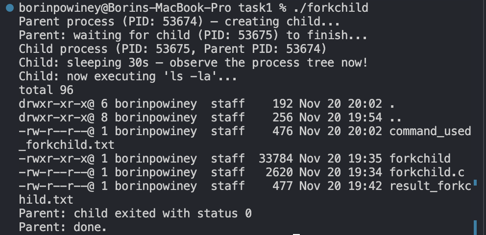
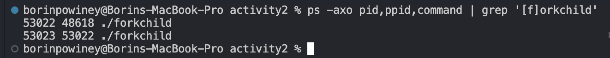
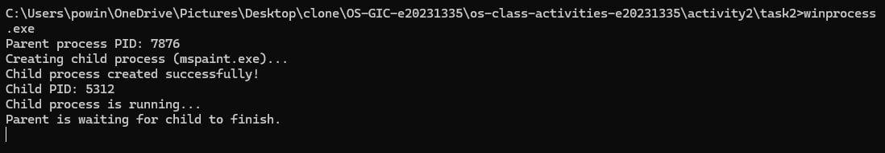
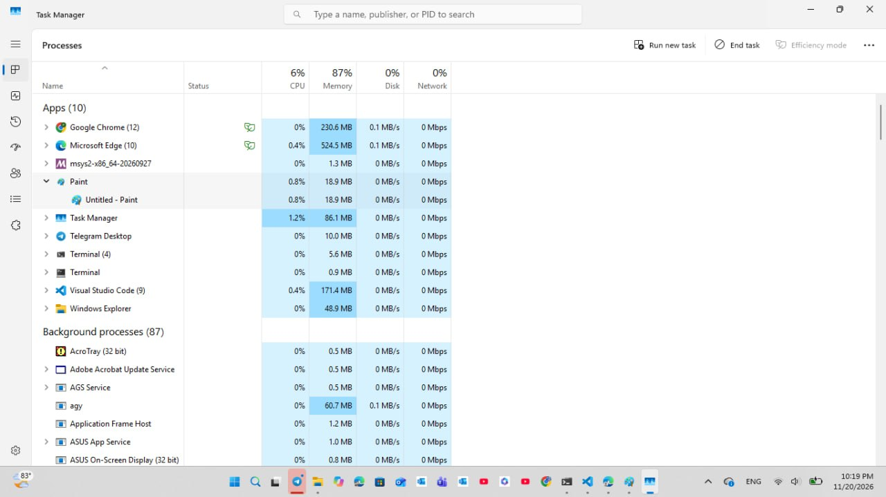
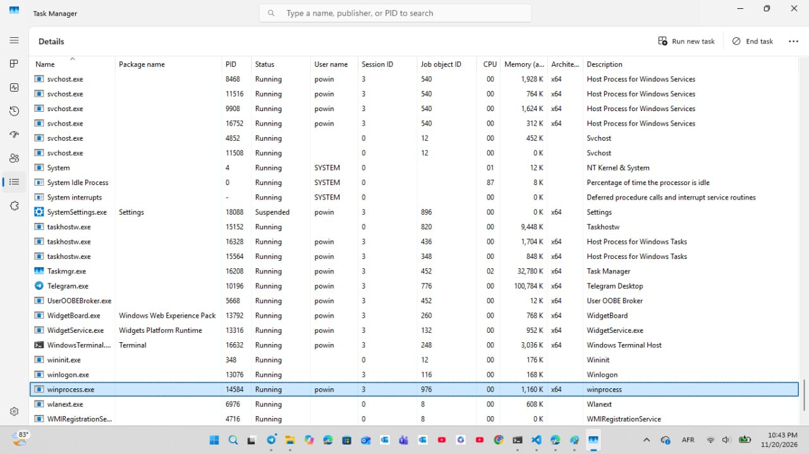
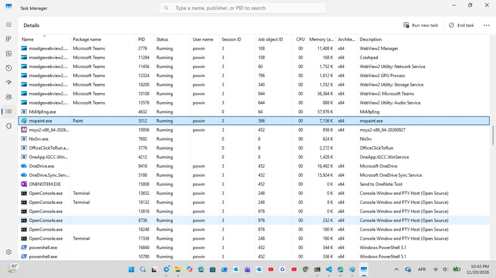
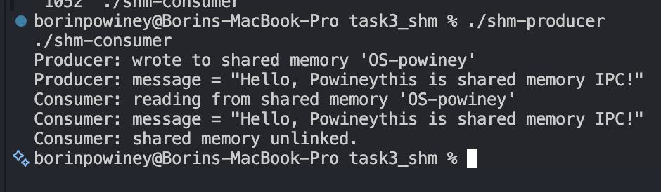
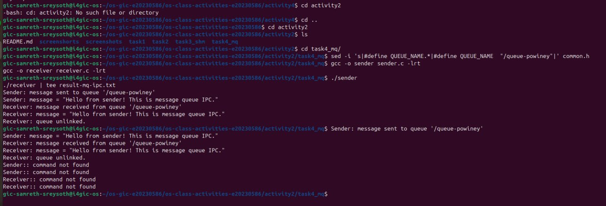

# Class Activity 2 — Processes & Inter-Process Communication

- **Student Name:** Borin Powiney
- **Student ID:** e20231335
- **Date:** 20/11/2026

---

## Task 1: Process Creation on Linux (fork + exec)

### Compilation & Execution

Screenshot of compiling and running `forkchild.c`:



### Process Tree

Screenshot of the parent-child process tree (using `ps --forest`, `pstree`, or `htop` tree view):



### Output

```
[Paste the content of result_forkchild.txt here]
```

### Questions

1. **What does `fork()` return to the parent? What does it return to the child?**

   > fork() returns the child PID to the parent and 0 to the child. On failure, it returns -1 to the parent.

2. **What happens if you remove the `waitpid()` call? Why might the output look different?**

   > Without waitpid(), the parent may finish before the child. Output order may change, and the parent will not obtain or check the child's exit status. The child may also become a zombie if it exits before the parent reaps it.

3. **What does `execlp()` do? Why don't we see "execlp failed" when it succeeds?**

   > execlp() searches for the program using PATH and replaces the child process with the new program. We do not see "execlp failed" when it succeeds because execlp() does not return after a successful replacement.

4. **Draw the process tree for your program (parent → child). Include PIDs from your output.**

   forkchild (parent PID: [53022])
└── forkchild/ls (child PID: [53023])

5. **Which command did you use to view the process tree (`ps --forest`, `pstree`, or `htop`)? What information does each column show?**

   > A suitable command is ps -ef --forest. Its columns include:
>UID: process owner
>PID: process ID
>PPID: parent process ID
>STIME: process start time
>TTY: controlling terminal
>TIME: CPU time used
>CMD: command and arguments
>The indentation shows the parent-child hierarchy.

---

## Task 2: Process Creation on Windows

### Compilation & Execution

Screenshot of compiling and running `winprocess.c`:



### Task Manager Screenshots

Screenshot showing process tree in the **Processes** tab (mspaint nested under your program):



Screenshot showing PID and Parent PID in the **Details** tab:





### Questions

1. **What is the key difference between how Linux creates a process (`fork` + `exec`) and how Windows does it (`CreateProcess`)?**

  > Linux uses fork() to create a copy of the parent process and then exec() to replace the child with another program. Windows uses CreateProcess() to create and start the child program in one operation.


2. **What does `WaitForSingleObject()` do? What is its Linux equivalent?**

   > WaitForSingleObject() blocks the parent until the specified object enters a signaled state. For a child process, it waits for the process to exit. On Linux, waitpid() performs the equivalent wait for a child.

3. **Why do we need to call `CloseHandle()` at the end? What happens if we don't?**

   > CloseHandle() closes the process and thread handles returned by CreateProcess(). It releases resources and prevents handle leaks. It does not terminate the child process.


4. **In Task Manager, what was the PID of your parent program and the PID of mspaint? Do they match your program's output?**

   > Parent winprocess.exe PID: [PID printed by your program]
>Child mspaint.exe PID: [11364]
>Parent PID reported for mspaint.exe: [14584]

5. **Compare the Processes tab (tree view) and the Details tab (PID/PPID columns). Which view makes it easier to understand the parent-child relationship? Why?**

   > The Processes tab is easier for quickly understanding the hierarchy because it visually nests child processes under their parents. The Details tab or Command Prompt is more precise because it displays exact PID and Parent PID values. Since your Task Manager does not show Parent PID, Command Prompt is valid evidence of the relationship.

---

## Task 3: Shared Memory IPC

### Compilation & Execution

Screenshot of compiling and running `shm-producer` and `shm-consumer`:



### Output

```
[Paste the content of result-shm-ipc.txt here]
```

### Questions

1. **What does `shm_open()` do? How is it different from `open()`?**

   > shm_open() creates or opens a named POSIX shared-memory object and returns a file descriptor. open() normally opens an ordinary filesystem file. Shared memory is intended for mapping data into process address spaces.

2. **What does `mmap()` do? Why is shared memory faster than other IPC methods?**

   > mmap() maps a file or shared-memory object into a process's address space, allowing access through a pointer. Shared memory is fast because processes read and write the mapped memory directly without copying data through the kernel for every IPC operation.

3. **Why must the shared memory name match between producer and consumer?**

   > The name identifies the shared-memory object. Both programs must use the exact same name to access the same memory region.

4. **What does `shm_unlink()` do? What would happen if the consumer didn't call it?**

   > shm_unlink() removes the object's name. The object is released after it is unlinked and all mappings and descriptors are closed. If the consumer does not unlink it, the object may remain and stale data or resource usage may remain for later runs.

5. **If the consumer runs before the producer, what happens? Try it and describe the error.**

   > If the consumer runs before the producer, shm_open() fails with ENOENT (No such file or directory) because the consumer does not use O_CREAT.

---

## Task 4: Message Queue IPC

### Compilation & Execution

Screenshot of compiling and running `sender` and `receiver`:



### Output

```
[Paste the content of result-mq-ipc.txt here]
```

### Questions

1. **How is a message queue different from shared memory? When would you use one over the other?**

   > Shared memory gives processes direct access to the same memory region and is suitable for large or frequently exchanged data. Message queues send independent, ordered messages managed by the kernel and are often easier to use for event or request/response communication.

2. **Why does the queue name in `common.h` need to start with `/`?**

   > POSIX message queue names must begin with /, for example /queue-borin. Both programs use the same name to identify the same queue.


3. **What does `mq_unlink()` do? What happens if neither the sender nor receiver calls it?**

   > mq_unlink() removes the queue name. The queue is released after it is unlinked and all processes close their descriptors. If neither program unlinks it, it may remain with its messages and consume system resources.

4. **What happens if you run the receiver before the sender?**

   > If the receiver runs first, mq_open() fails with ENOENT because the sender has not created the queue with O_CREAT.


5. **Can multiple senders send to the same queue? Can multiple receivers read from the same queue?**
   
   > Multiple processes can send to the same queue. Multiple processes can also receive from it, but each message is removed and delivered to only one receiver; messages are not broadcast to every receiver.[Your answer]

---

## Reflection

What did you learn from this activity? What was the most interesting difference between Linux and Windows process creation? Which IPC method do you prefer and why?

> This activity helped me learn how operating systems create processes and enable communication between isolated process address spaces. The most interesting difference was that Linux creates processes with fork() followed by exec(), while Windows creates and starts them using CreateProcess(). Shared memory provides faster direct access, but message queues are easier to manage because the operating system handles message storage and retrieval.