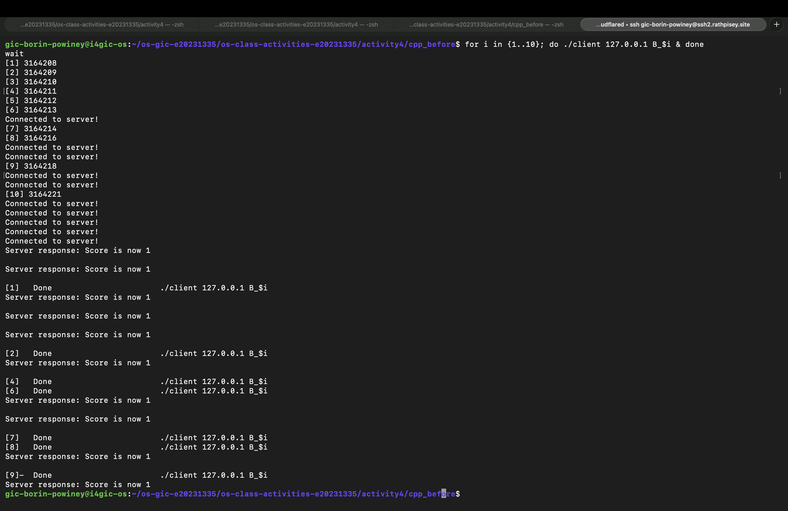
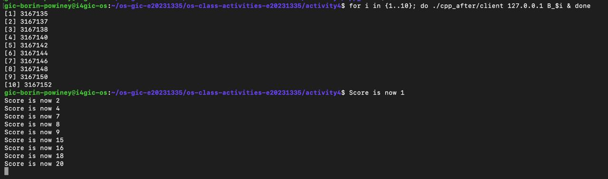
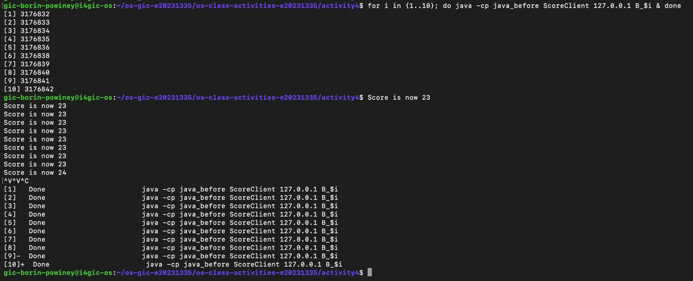
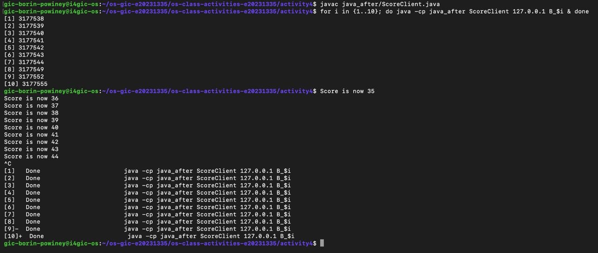

# Class Activity 4 — Shared File API

- **Student Name:** Borin Powiney
- **Student ID:** e20231335
- **Partner Name:** Ly Nyheang
- **Partner Student ID:** e20230906
- **Server Machine Owner:** [Your Name or Partner Name]
- **Server IP Address:** 192.168.71.175

---

## Task 1: C++ Before Mutex

- Expected score after 20 total client requests:
- Actual score:
- What happened:

---

## Task 2: C++ After Mutex

- Expected score after 20 total client requests:
- Actual score:
- What changed after adding mutex:

---

## Task 3: Java Before Synchronized

- Expected score after 20 total client requests:
- Actual score:
- What happened:

---

## Task 4: Java After Synchronized

- Expected score after 20 total client requests:
- Actual score:
- What changed after adding synchronized:

---

## Questions

1. Why should clients send requests to the server instead of writing the file directly?
 >Centralizing updates prevents uncontrolled file access. The server becomes the authority for the shared resource and can enforce synchronization consistently.

2. Why does the server still have a race condition before mutex or synchronized?
>It creates one thread per client. Different threads can read, modify, and write the file concurrently. The read–modify–write sequence is not atomic.

3. In the C++ fixed version, what does `std::lock_guard<std::mutex>` protect?
>It protects the complete file-update operation in update_score(): reading the file, calculating the new value, sleeping, and writing the file.

4. In the Java fixed version, what does `synchronized` protect?
>It protects the entire updateScore() method. For a static method, the lock belongs to the class. Only one thread may execute that method at a time.

5. Why is the final score expected to be 20 when Student A sends 10 requests and Student B sends 10 requests?
>Each student sends 10 successful requests: 10 Student A requests + 10 Student B requests = 20 increments

6. What could happen if two separate servers update the same file at the same time?
>They would need separate synchronization with each other. Two independent servers can still race because one server’s mutex or Java monitor does not protect threads running in the other server process. The result could be lost or corrupted updates.
---

## Reflection

_Compare the C++ and Java synchronization approaches. What did this activity teach you about protecting shared resources?_